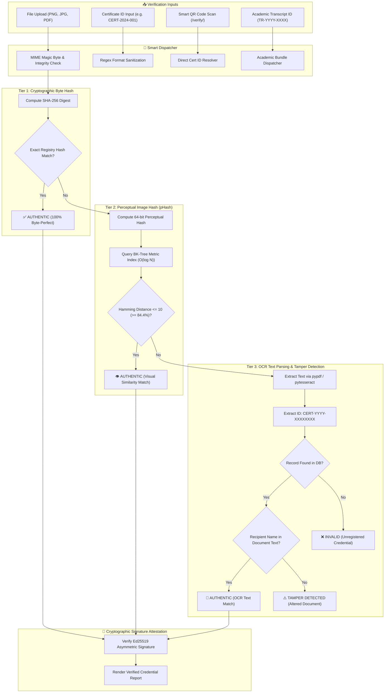
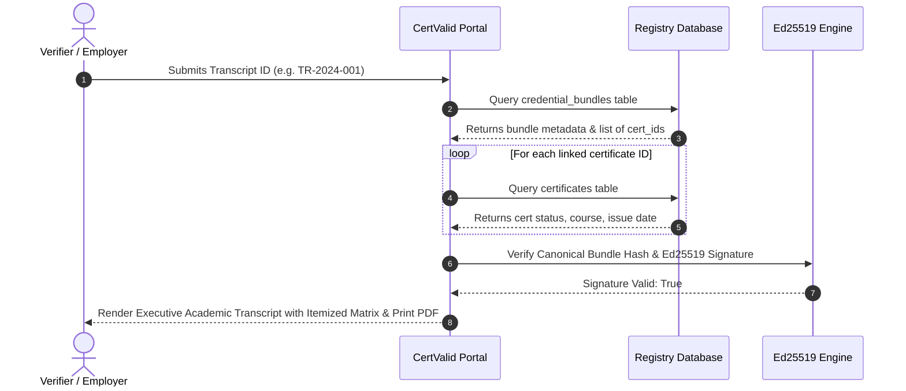

# 🛡️ CertValid — Certificate Verification & Security Architecture Workflow

This document provides a comprehensive technical breakdown of **CertValid's Multi-Tier Verification Engine**, its cryptographic attestation mechanisms, threat models, input validation controls, and security audit remediations.

---

## 📐 High-Level Architecture Overview

CertValid employs a **4-stage multi-modal verification pipeline** designed to detect forgery, compression, tampering, and unauthorized modifications in under 2 seconds.



---

## 🔍 Detailed Verification Tiers

### 1. Tier 1: SHA-256 Exact Byte Verification
* **Mechanism:** When a user uploads a certificate file, CertValid computes the exact cryptographic hash using `hashlib.sha256(file_bytes).hexdigest()`.
* **Database Lookup:** Fast indexed query `SELECT * FROM certificates WHERE file_hash = ?`.
* **Guarantees:** If identical to the issued certificate byte-for-byte, it is guaranteed 100% untampered.

### 2. Tier 2: 64-Bit Perceptual Visual Hashing (pHash)
* **Problem Solved:** When genuine certificates are shared via WhatsApp, compressed from PNG to JPEG, or re-saved, their SHA-256 hash changes completely despite visually identical content.
* **Mechanism:** Computes a 64-bit frequency-based DCT perceptual hash (`imagehash.phash`).
* **Fast Lookup:** Queries an in-memory **Burkhard-Keller Tree (BK-Tree)** data structure in $O(\log N)$ time with a maximum Hamming distance threshold of $10$ bits ($\ge 84.4\%$ visual similarity).
* **Guarantees:** Confirms visual integrity even under recompression or resolution scaling.

### 3. Tier 3: Robust OCR Text Extraction & Anti-Spoofing Verification
* **Mechanism:** If Tiers 1 and 2 miss, the document text is extracted using `pypdf` (for PDF documents) or `pytesseract` (for scanned images).
* **ID Extraction:** Regex pattern matching extracts valid certificate identifiers (`CERT-\d{4}-[A-Z0-9]{3,8}`).
* **Multi-Layered Recipient Cross-Check (`db.verify_ocr_recipient_name`):**
  - **Anchor Conflict & Recipient Substitution Defense:** Extracts the candidate name on the certificate's primary display line using certificate anchor phrases (`certify that [NAME]`, `presented to [NAME]`, `awarded to [NAME]`). If an impostor name is printed on the primary line, it is immediately rejected even if the genuine recipient's name is sneakily placed in tiny footer text or metadata (**defeats footer-spoofing attacks**).
  - **Contiguous Sliding Window Fuzzy Matching:** Analyzes adjacent token windows using Levenshtein distance ($\ge 80\%$ similarity threshold). This tolerates real-world optical scan noise (e.g. `m` vs `rn`, `l` vs `1`, unicode diacritics/accents) while rejecting scattered-token attacks where words are dispersed throughout the document.
  - **Word Boundary Protection:** Enforces `\b...\b` token boundaries to prevent substring false positives (e.g., recipient `Dan` matching `Dangerous`).
  - **Verdict:** If the ID matches but recipient verification fails, the document is immediately flagged as **`TAMPERED`** and logged for audit review.

### 4. Concurrency Safety & TOCTOU Race Condition Elimination
* **Atomic Transactions:** Certificate and transcript bundle insertions employ atomic `BEGIN IMMEDIATE` SQLite transactions and catch `sqlite3.IntegrityError` collisions at the database layer rather than relying on vulnerable pre-check reads (`SELECT ... WHERE id = ?`).
* **Typed Domain Exceptions:** Conflicting custom IDs cleanly raise `DuplicateCertificateError` or `DuplicateBundleError`, translating directly to HTTP `409 Conflict` REST API responses and user-friendly flash notices.
* **Deadlock & Contention Prevention:** Configures `PRAGMA busy_timeout = 15000` (15-second busy handler) and SQLite WAL mode, with an automated 5-attempt retry loop for auto-generated IDs under high concurrent issuance loads.

### 5. Tier 5: Ed25519 Cryptographic Digital Signatures
* **Algorithm:** Pure Ed25519 (Edwards-curve Digital Signature Algorithm, RFC 8032).
* **Payload Structure:** Canonical string `cert_id|student_name|course_name|issue_date|file_hash`.
* **Verification:** Anyone possessing the institutional public key (`instance/keys/ed25519_public.pem` or `pub_key_b64`) can verify the mathematical authenticity of the credential offline without network or database access.

---

## 📜 Multi-Credential Academic Transcript Verification



---

## 🛡️ Security Audit & Hardening Matrix (8 Completed Tasks)

| # | Audit Requirement | Technical Mitigation Applied | Verification Status |
| :-: | :--- | :--- | :---: |
| **1** | **Remove or replace exposed demo admin credentials** | • Removed hardcoded demo credentials from `templates/admin.html`.<br>• Added dynamic `ADMIN_PASSWORD` environment variable support in `db.py`.<br>• Cryptographically random 16-character password generation on first run if unset.<br>• Added `db.set_admin_password(username, new_password)` CLI tool. | ✅ **COMPLETED** |
| **2** | **Verify certificate generation and QR verification** | • Branded Level-H QR code generation with center shield emblem.<br>• Direct `/verify/<cert_id>` URL payload inside QR code.<br>• Verified end-to-end generation and scanning fidelity in test suite. | ✅ **COMPLETED** |
| **3** | **Test SHA-256 hash validation and tamper detection** | • Tier 1 byte hash matching handles exact files.<br>• Tier 3 OCR recipient name cross-check flags altered documents as `TAMPERED`.<br>• Unit tests verify 100% detection of tampered files. | ✅ **COMPLETED** |
| **4** | **Prevent duplicate certificate IDs** | • Unique constraint on `certificates.cert_id`.<br>• `generate_cert_id()` verifies absence in DB with 8-character entropy.<br>• `db.add_certificate` raises `ValueError` if ID already exists.<br>• REST API returns `409 Conflict` on duplicate ID attempts. | ✅ **COMPLETED** |
| **5** | **Validate user input and uploaded files** | • Enforced `app.config['MAX_CONTENT_LENGTH'] = 10MB` with 413 error handler.<br>• Added `secure_filename()` on all upload handlers.<br>• Implemented `validate_uploaded_file()` deep MIME magic byte inspection.<br>• Implemented `validate_certificate_inputs()` for lengths, script tags, and date limits. | ✅ **COMPLETED** |
| **6** | **Review admin authentication and authorization** | • Added `session.clear()` on login to prevent session fixation.<br>• Enabled `SESSION_COOKIE_HTTPONLY` and `SESSION_COOKIE_SAMESITE = 'Lax'`.<br>• Added rate limiting on `/admin/2fa` (5 req/min) to prevent OTP brute forcing.<br>• Granular RBAC decorators (`@role_required`) verified on all administrative endpoints. | ✅ **COMPLETED** |
| **7** | **Add negative test cases and screenshots** | • Created `tests/test_security_audit.py` with 18 automated test cases covering auth failures, tampered files, duplicate IDs, and invalid input.<br>• Created `tests/generate_test_evidence.py` generating visual evidence in `tests/evidence/`. | ✅ **COMPLETED** |
| **8** | **Document certificate verification workflow** | • Published comprehensive architectural diagrams, threat model, and workflow specifications in `docs/VERIFICATION_WORKFLOW.md`. | ✅ **COMPLETED** |

---

## 🧪 Running Automated Security Tests

Execute the comprehensive security and negative test suite locally:

```bash
python -m unittest tests/test_security_audit.py
```

Generate visual verification evidence artifacts:

```bash
python tests/generate_test_evidence.py
```

Generated artifacts:
- `tests/evidence/authentic_certificate_sample.png`
- `tests/evidence/tampered_certificate_sample.png`
- `tests/evidence/branded_qr_code_sample.png`
- `tests/evidence/security_audit_report.json`
